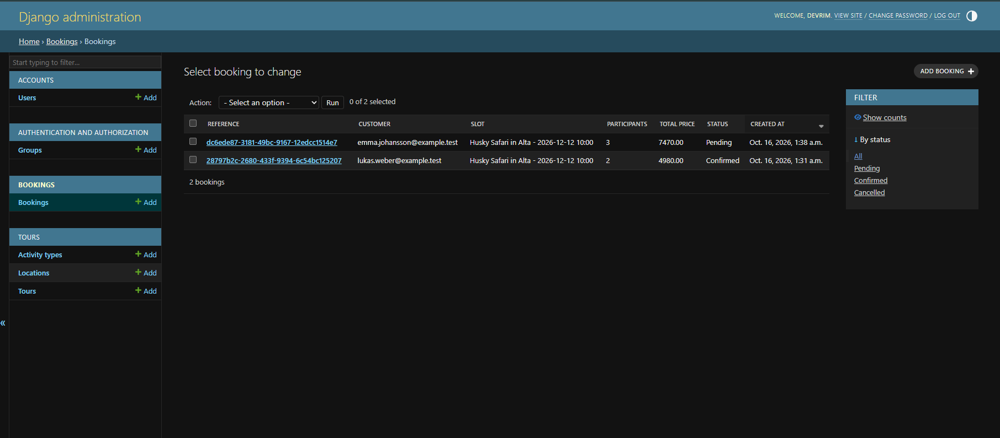
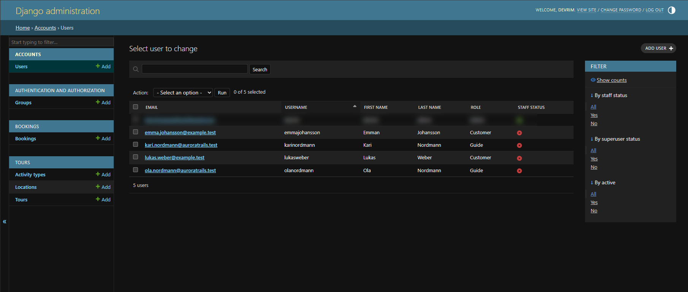
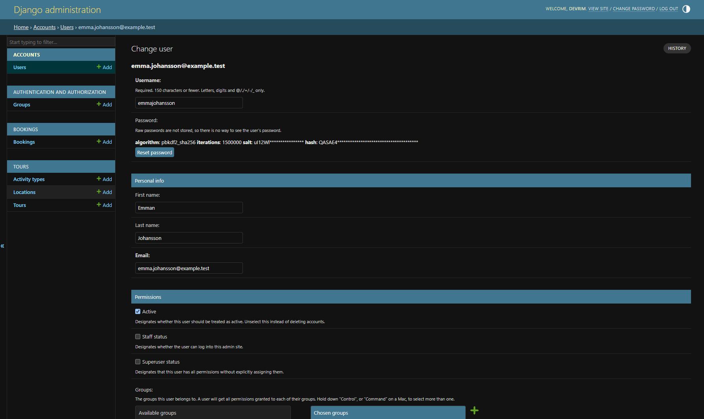

# Aurora Trails

A booking platform for Arctic adventure tours in Northern Norway. Guides publish tours such as husky safaris, northern lights tours and Sami culture experiences, and customers book them by date and available capacity.

## Why This Project

This project is personal to me. As a developer with a background in Arctic tourism, including working as a tour guide in Alta, I know the challenges of the industry from the inside. I have previously presented to Innovasjon Norge on how digitalization could strengthen tourism in Northern Norway. Many tour operators in the region are small, often just a few guides, and they lack simple digital tools to reach visitors and manage bookings. Aurora Trails is my attempt to build that tool: a platform where local guides can offer their experiences and travelers can discover and book them easily, helping small businesses grow and bringing more visitors to the Arctic.

> Work in progress.

## Roadmap 
_Last_updated :2026-10-18

- [x] PostgreSQL setup with environment-based configuration
- [x] Custom user model with roles (guide, customer, admin) and email login
- [x] Data models: guides, activity types, locations, tours, tour slots, bookings
- [x] Customized Django admin
- [x] REST API: tour list and tour detail with live slot availability
- [x] REST API: booking creation with server-side price calculation
- [x] Capacity-safe booking (row locking with `select_for_update` to prevent overbooking)
- [x] Role-based permissions: customers only can create bookings
- [x] Automated tests, including concurrent booking scenarios
- [x] REST API: customer booking history ("my bookings")
- [x] REST API: booking cancellation by customers
- [ ] Role-based permissions and endpoints for guides
- [x] Token-based authentication for the frontend
- [ ] Weather and aurora forecast integration (MET Norway API)
- [ ] Reviews
- [ ] Angular frontend

## Tech Stack

- Python 3.14
- Django 6.1
- PostgreSQL

## Getting Started

```bash
# Create and activate a virtual environment
python -m venv venv
venv\Scripts\activate

# Install dependencies
pip install -r requirements.txt

# Configure the database
# Copy aurora_trails/.env.example to aurora_trails/.env and fill in your PostgreSQL credentials
# Generate a SECRET_KEY with:
# python -c "from django.core.management.utils import get_random_secret_key; print(get_random_secret_key())"

# Run migrations and start the server
cd aurora_trails
python manage.py migrate
python manage.py runserver
```

## Screen Shots




