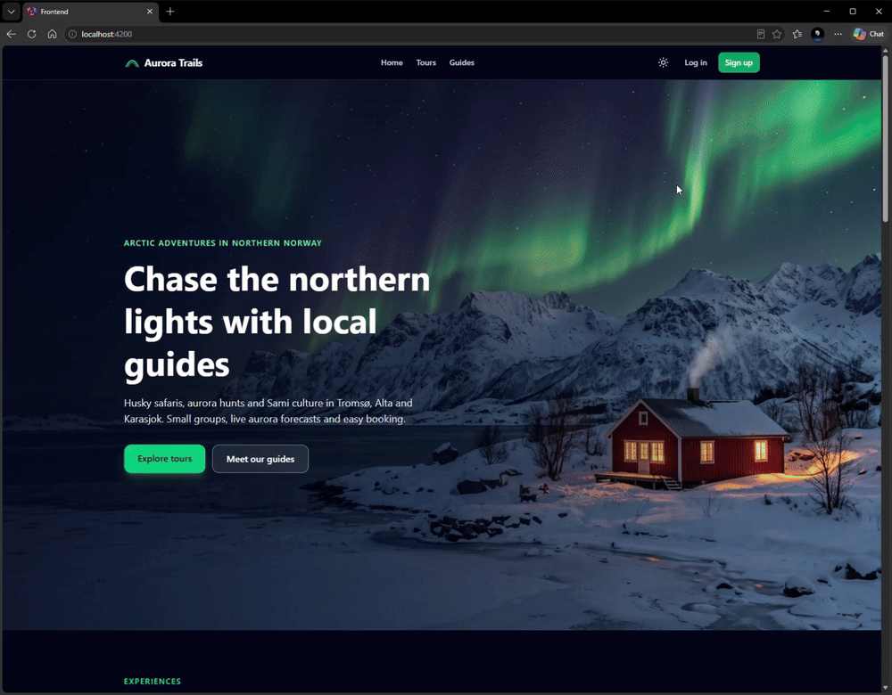
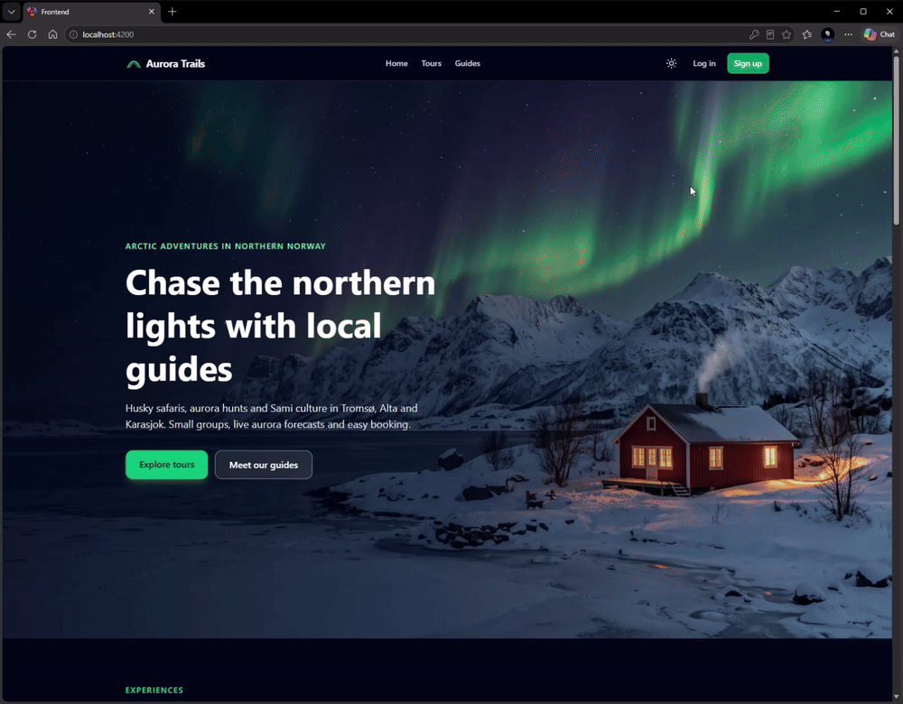
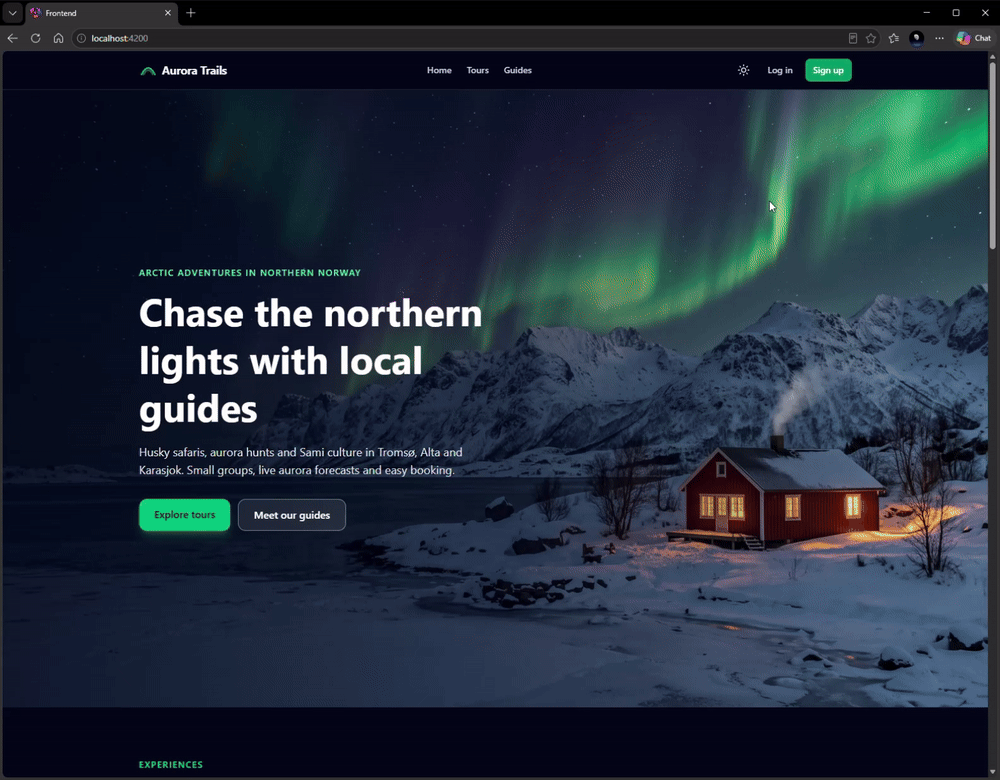

# Aurora Trails


A booking platform for Arctic adventure tours in Northern Norway. Guides publish tours such as husky safaris, northern lights tours and Sami culture experiences, and customers book them by date and available capacity.

## Why This Project

This project is personal to me. As a developer with a background in Arctic tourism, including working as a tour guide in Alta, I know the challenges of the industry from the inside. I have previously presented to Innovasjon Norge on how digitalization could strengthen tourism in Northern Norway. Many tour operators in the region are small, often just a few guides, and they lack simple digital tools to reach visitors and manage bookings. Aurora Trails is my attempt to build that tool: a platform where local guides can offer their experiences and travelers can discover and book them easily, helping small businesses grow and bringing more visitors to the Arctic.

> Work in progress.

## Roadmap

_Last updated: 2026-10-23_

- [x] PostgreSQL setup with environment-based configuration
- [x] Custom user model with roles (guide, customer, admin) and email login
- [x] Data models: guides, activity types, locations, tours, tour slots, bookings
- [x] Customized Django admin
- [x] REST API: tour list and tour detail with live slot availability
- [x] REST API: booking creation with server-side price calculation
- [x] Capacity-safe booking (row locking with `select_for_update` to prevent overbooking)
- [x] Role-based permissions: customers only can create bookings
- [x] Automated tests, including concurrent booking scenarios
- [x] REST API: customer booking history ("my bookings")
- [x] REST API: booking cancellation by customers
- [x] Role-based permissions and endpoints for guides
- [x] Token-based authentication for the frontend
- [x] Customer self-registration with automatic login (guides are added by admins only)
- [x] Current user endpoint for role-based navigation in the frontend
- [x] Weather and aurora forecast integration (MET Norway API)
- [x] Aurora forecast (Kp index from NOAA, combined with cloud cover)
- [x] Continuous integration with GitHub Actions (tests run against PostgreSQL on every push)
- [x] Reviews (only for confirmed bookings after the tour has ended)
- [x] Public guide profiles for the frontend
- [x] Image uploads for tours and guide profiles (cover image in the tour list, gallery in the tour detail)
- [x] Tour filtering by location, activity type, difficulty, price and date range
- [x] Guide view of bookings for their own tours (customer contact details for operational use)
- [x] Booking actions for the frontend (`can_cancel`, `can_review`, `has_review`), sharing the same rules as the service layer
- [x] OpenAPI documentation with Swagger UI and ReDoc, schema validated in CI
- [x] Pagination for the tour list and reviews
- [x] Rate limiting on login and registration
- [x] Angular frontend

## Tech Stack

- Python 3.14, Django 6.1
- Django REST Framework, Simple JWT
- PostgreSQL (row locking with `select_for_update`)
- django-filter, django-cors-headers, Pillow
- requests (MET Norway and NOAA integrations)
- GitHub Actions (CI with a PostgreSQL service container)
- Angular, TypeScript, RxJS, Tailwind CSS (frontend)

## Getting Started

Uploaded images are stored in `aurora_trails/media/`, which is not committed to the repository. Upload tour and guide images through the Django admin.

```bash
# Create and activate a virtual environment
python -m venv venv
venv\Scripts\activate

# Install dependencies
pip install -r requirements.txt

# Configure the database
# Copy aurora_trails/.env.example to aurora_trails/.env and fill in your PostgreSQL credentials
# Generate a SECRET_KEY with:
# python -c "from django.core.management.utils import get_random_secret_key; print(get_random_secret_key())"

# Run migrations and start the server
cd aurora_trails
python manage.py migrate
python manage.py runserver
```

## Frontend

The frontend is an Angular single-page application in the `frontend/` folder, styled with Tailwind CSS (v4) and supporting light and dark mode.

### Features

- **Visitors:** home page with featured tours and guides, tour list with filters and pagination, tour details with gallery, live availability, weather and aurora forecast per date, reviews, guide profiles
- **Customers:** sign up and log in (also directly from the booking flow), book a tour, view upcoming and past bookings, cancel, write reviews
- **Guides:** guide panel with upcoming groups and customer contacts, manage tours and dates, publish or hide tours, create new tours

### Architecture

- Standalone components, signals and the new control flow (`@if`, `@for`, `@switch`)
- **Services** per API area (`TourService`, `BookingService`, `AuthService`, ...) with typed models matching the API
- **HTTP interceptor** adds the JWT access token to API requests and refreshes it automatically when it expires
- **Route guards** (`roleGuard('customer')`, `roleGuard('guide')`) for role-based pages. Real authorization is enforced by the API.
- **App initializer** restores the logged-in user before the first render, so the UI never flashes the wrong state
- **URL-driven filters:** tour filters live in the query string, so filtered results can be shared and the back button works
- **Environment files** for the API base URL in development and production

### Running the frontend

The backend must be running on `http://localhost:8000`.

```bash
cd frontend
npm ci
npx ng serve
```

Open `http://localhost:4200`.

### Screenshots

**Home page and tours**



**Customer booking flow**



**Guide panel**



## API Documentation

Interactive API documentation is generated automatically from the code with [drf-spectacular](https://drf-spectacular.readthedocs.io/) (OpenAPI 3).

| URL            | Description                                           |
| -------------- | ----------------------------------------------------- |
| `/api/docs/`   | Swagger UI: browse and try every endpoint             |
| `/api/redoc/`  | ReDoc: read-only reference documentation              |
| `/api/schema/` | Raw OpenAPI schema (YAML), for client code generation |

### Trying authenticated endpoints in Swagger

1. Call `POST /api/auth/token/` with an email and password
2. Copy the `access` token from the response
3. Click **Authorize** and paste the token
4. Customer and guide endpoints can now be called directly from the page

The schema can also be used to generate a typed frontend client, for example with `ng-openapi-gen` for Angular.

## API Endpoints

Authenticated endpoints require an `Authorization: Bearer <access_token>` header.

| Method          | Endpoint                            | Access        | Description                                                                                    |
| --------------- | ----------------------------------- | ------------- | ---------------------------------------------------------------------------------------------- |
| POST            | `/api/auth/token/`                  | Public        | Log in with email and password, returns access and refresh tokens                              |
| POST            | `/api/auth/token/refresh/`          | Public        | Get a new access token using a refresh token                                                   |
| GET             | `/api/tours/`                       | Public        | List active tours                                                                              |
| GET             | `/api/tours/<id>/`                  | Public        | Tour details with upcoming slots and available spots                                           |
| GET             | `/api/tours/<id>/forecast/`         | Public        | Weather forecast for each upcoming slot (MET Norway)                                           |
| POST            | `/api/bookings/`                    | Customer      | Create a booking (`slot`, `participants`)                                                      |
| GET             | `/api/bookings/me/`                 | Customer      | List the logged-in customer's bookings, with `can_cancel`, `can_review` and `has_review` flags |
| POST            | `/api/bookings/<reference>/cancel/` | Customer      | Cancel a booking                                                                               |
| GET, POST       | `/api/guide/tours/`                 | Guide         | List own tours or create a new tour                                                            |
| GET, PUT, PATCH | `/api/guide/tours/<id>/`            | Guide         | View or update an own tour                                                                     |
| GET, POST       | `/api/guide/tours/<id>/slots/`      | Guide         | List slots or add a new slot to an own tour                                                    |
| GET             | `/api/tours/<id>/reviews/`          | Public        | List reviews of a tour                                                                         |
| POST            | `/api/bookings/<reference>/review/` | Customer      | Review a finished tour (`rating`, `comment`)                                                   |
| POST            | `/api/auth/register/`               | Public        | Create a customer account, returns the user and access/refresh tokens                          |
| GET             | `/api/auth/me/`                     | Authenticated | Details and role of the logged-in user                                                         |
| GET             | `/api/guides/`                      | Public        | List guides with bio, languages and base location                                              |
| GET             | `/api/guides/<id>/`                 | Public        | Guide details                                                                                  |
| GET             | `/api/locations/`                   | Public        | List locations (for filter dropdowns)                                                          |
| GET             | `/api/activity-types/`              | Public        | List activity types (for filter dropdowns)                                                     |
| GET             | `/api/guide/bookings/`              | Guide         | Bookings for own tours, filterable by `slot` and `status`                                      |

## Filtering

The tour list supports filtering through query parameters, built with [django-filter](https://django-filter.readthedocs.io/). Invalid values (an unknown location ID, a malformed date) return `400 Bad Request` with a clear error message. In the browsable API, the **Filters** button shows a form for all parameters.

| Parameter       | Type                                  | Example                 | Description                                        |
| --------------- | ------------------------------------- | ----------------------- | -------------------------------------------------- |
| `location`      | ID                                    | `?location=2`           | Tours in a given location                          |
| `activity_type` | ID                                    | `?activity_type=1`      | Tours of a given activity type                     |
| `difficulty`    | `easy` \| `moderate` \| `challenging` | `?difficulty=easy`      | Tours with a given difficulty                      |
| `max_price`     | Number (NOK)                          | `?max_price=2000`       | Tours with a price per person up to this amount    |
| `date_from`     | Date (`YYYY-MM-DD`)                   | `?date_from=2026-12-01` | Tours with an upcoming slot on or after this date  |
| `date_to`       | Date (`YYYY-MM-DD`)                   | `?date_to=2026-12-15`   | Tours with an upcoming slot on or before this date |

Parameters can be combined:

```
GET /api/tours/?location=2&difficulty=easy&date_from=2026-12-01&date_to=2026-12-15
```

## Pagination

The tour list and tour reviews are paginated (12 items per page by default). Use `page` and `page_size` (max 50):

```
GET /api/tours/?page=2&page_size=6
```

```json
{
  "count": 37,
  "next": "http://localhost:8000/api/tours/?page=3&page_size=6",
  "previous": "http://localhost:8000/api/tours/?page=1&page_size=6",
  "results": [ ... ]
}
```

Filters and pagination can be combined. Lookup lists (locations, activity types) are not paginated, since dropdowns need every item.

## Rate Limiting

Login and registration are rate limited to prevent brute-force password attempts and mass account creation. Limits use DRF's `ScopedRateThrottle` with an `auth` scope.

| Endpoint                   | Limit                             |
| -------------------------- | --------------------------------- |
| `POST /api/auth/token/`    | 10 requests per minute per client |
| `POST /api/auth/register/` | 10 requests per minute per client |

When the limit is exceeded, the API returns `429 Too Many Requests` with the remaining wait time:

```json
{ "detail": "Request was throttled. Expected available in 58 seconds." }
```

### Trying it out

PowerShell:

```powershell
1..11 | ForEach-Object { try { Invoke-RestMethod -Method Post -Uri http://localhost:8000/api/auth/token/ -ContentType "application/json" -Body '{"email":"x@test.no","password":"wrong"}' } catch { "$_ : $($_.Exception.Response.StatusCode.value__)" } }
```

Bash:

```bash
for i in $(seq 1 11); do curl -s -o /dev/null -w "%{http_code}\n" -X POST http://localhost:8000/api/auth/token/ -H "Content-Type: application/json" -d '{"email":"x@test.no","password":"wrong"}'; done
```

The first 10 requests return `401`, the 11th returns `429`.

> Request counts are stored in Django's cache. The default in-memory cache is per process, so a production deployment with several workers should use a shared cache such as Redis.

### Implementation notes

- **Date range on the same slot:** `date_from` and `date_to` are evaluated together, so a tour matches only if a single slot falls inside the range. A tour with one slot before the range and another after it is not returned.
- **Subquery instead of a join:** the date filter uses `id__in` with a subquery on tour slots. Joining slots directly would duplicate rows and distort the annotated `average_rating` and `review_count`.
- **Only upcoming slots count:** past slots never make a tour match a date search.
- **Time zone aware:** dates are compared in the configured time zone (`Europe/Oslo`), so a slot at 00:30 falls on the correct day.
- **Stable ordering:** results are always sorted by title.

## Testing

The project has 33 automated tests covering booking rules, permissions and external API integrations.

```bash
cd aurora_trails
python manage.py test -v 2
```

Django creates a temporary test database (`test_aurora_trails`) for each run and deletes it afterwards, so tests never touch real data. The PostgreSQL user therefore needs the `CREATEDB` permission.

### Test suites

| Test class             | Base class            | Database                  | What it covers                                                                                                                                                          |
| ---------------------- | --------------------- | ------------------------- | ----------------------------------------------------------------------------------------------------------------------------------------------------------------------- |
| `BookingCapacityTests` | `TransactionTestCase` | Yes, real commits         | Capacity limits, cancellation, and concurrent bookings competing for the same spots                                                                                     |
| `ReviewApiTests`       | `APITestCase`         | Yes, rolled back per test | Review rules: only the booking's customer, only confirmed and finished tours, one review per booking, rating 1-5, average rating in the tour list, booking action flags |
| `GuideBookingApiTests` | `APITestCase`         | Yes, rolled back per test | Guide booking list: only bookings for the guide's own tours, slot filter, customers rejected                                                                            |
| `GuideTourApiTests`    | `APITestCase`         | Yes, rolled back per test | Guide endpoints: tour ownership, role checks, capacity rules                                                                                                            |
| `TourForecastApiTests` | `APITestCase`         | Yes, rolled back per test | Forecast endpoint with MET Norway and NOAA mocked, including service outages                                                                                            |
| `TourImageApiTests`    | `APITestCase`         | Yes, rolled back per test | Tour images: cover image chosen by order, full URLs, all images in the detail, temporary media folder                                                                   |
| `TourFilterApiTests`   | `APITestCase`         | Yes, rolled back per test | Tour filters (location, price, date range on a single slot, invalid input), pagination and sorted lookup lists                                                          |
| `RegisterApiTests`     | `APITestCase`         | Yes, rolled back per test | Self-registration: always a customer, case-insensitive unique email, password strength, tokens returned                                                                 |
| `MeApiTests`           | `APITestCase`         | Yes, rolled back per test | Current user endpoint: returns details and role, requires authentication                                                                                                |
| `GuideListApiTests`    | `APITestCase`         | Yes, rolled back per test | Public guide list: only active guides with a profile, no private data                                                                                                   |
| `AuroraChanceTests`    | `SimpleTestCase`      | No                        | The aurora chance rule as a pure function                                                                                                                               |

### Why different test types?

- **`TransactionTestCase` for concurrency:** Django's default `TestCase` wraps each test in a transaction and rolls it back, which is fast but keeps everything in a single database connection. Row locking with `select_for_update` can only be tested with separate connections that really commit. The concurrency test starts two threads, each with its own connection, synchronized with a `threading.Barrier` so they hit the database at the same moment. Exactly one booking must succeed.
- **`APITestCase` for endpoints:** Tests send real HTTP requests through DRF's test client. `force_authenticate` simulates a logged-in user, and URLs are resolved by name with `reverse()`, so tests keep working if paths change.
- **`SimpleTestCase` for pure logic:** No database is created, which makes these the fastest tests.

### External APIs are mocked

Tests never call MET Norway or NOAA. `unittest.mock.patch` replaces the fetch functions with fakes that return minimal responses or raise errors. This keeps tests fast, deterministic and runnable offline, and avoids sending unnecessary traffic to public services.

## Screen Shots


## Data Sources

- Weather data from [MET Norway](https://api.met.no/), licensed under [CC BY 4.0](https://creativecommons.org/licenses/by/4.0/).
- Kp index data from the [NOAA Space Weather Prediction Center](https://www.swpc.noaa.gov/).
